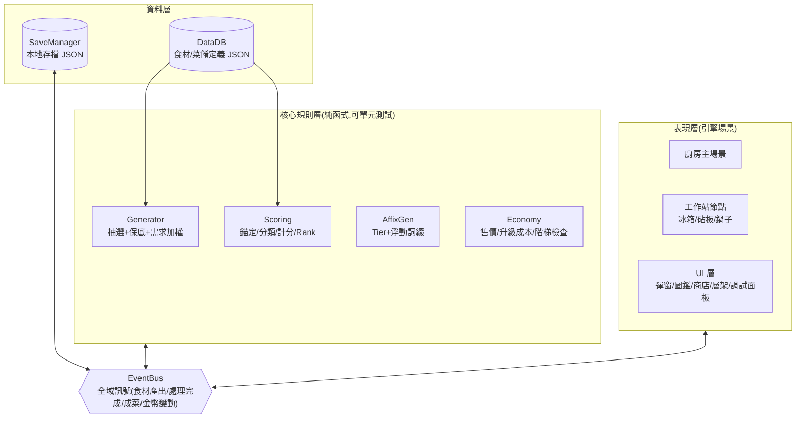
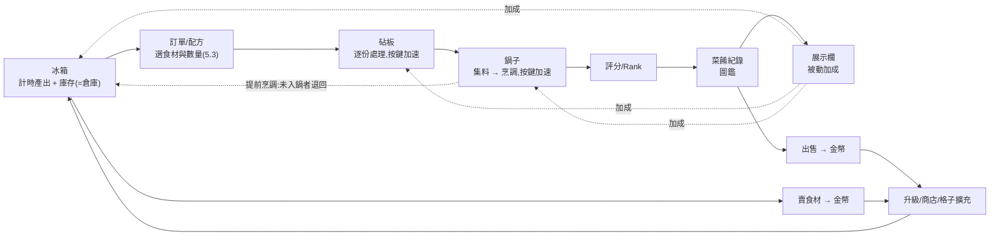
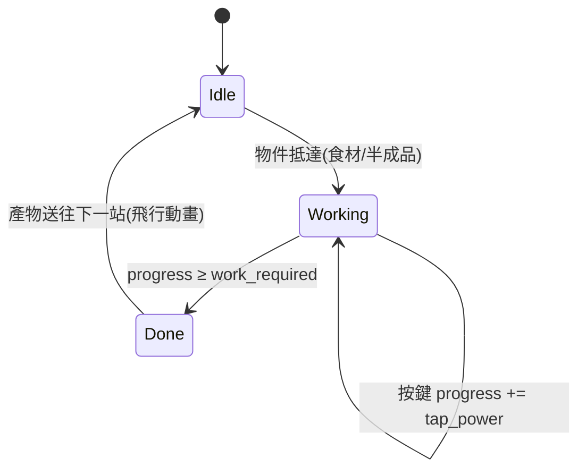
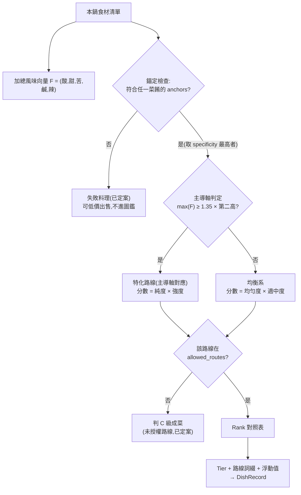
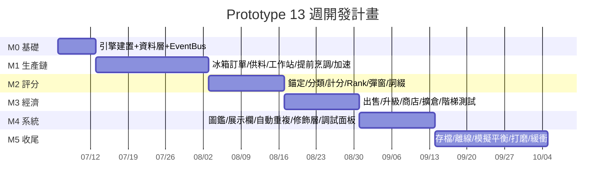

# 放置廚房 Prototype 技術文件

- 版本:v0.7(對應企劃書 v0.5)
- 日期:2026/07/03
- 定位:本文件把企劃書轉換成「可以動手做」的工程規格,包含資料模型、演算法、實作方式與 13 週里程碑。標示 **[Q?]** 的項目為待決策設計問題,彙整於第九章(含已定案紀錄)。

## 版本紀錄

| 版本 | 日期 | 主要變更 |
|---|---|---|
| v0.1 | 2026/07/03 | 初版:全系統規格、里程碑、待決策清單 |
| v0.2 | 2026/07/03 | 三項核心決策定案:引擎 Unity + C#(第二章改寫)、配方組成分段方案(5.3:手動配方盤 M1 + 自動重複 M4)、Steam 改為四個預留接口(新增 5.11);里程碑工時重排;新增 Q9 |
| v0.3 | 2026/07/03 | 核心流程定案為「冰箱訂單制」(5.3 全面改寫):提前烹調採甲界線(鍋內為準)、手動等按/自動重複自動開煮;倉庫與冰箱庫存合併為同一實體;新增訂單加權(5.1);Q7/Q8/Q9 全數結案;M1 +2h、M5 -2h |
| v0.4 | 2026/07/03 | 字型定案:單一 Fusion Pixel 12px(OFL-1.1 可商用),新增 6.4 TMP 設定指南;新增 7.1 現況對齊與 M0 缺項補課排程;字型風險解除 |
| v0.5 | 2026/07/05 | 計分系統全參數定案回寫(對應企劃書 v0.5):主導門檻 1.35 / cap 10 / 幫襯 0.45 / 衰減 0.6 / 超標懲罰入 M2 / 均衡開根號+2.5~6.5;鍋容量 10 成為訂單上限;起始食材 9 種(企劃書附錄 A);Q3/Q5/Q6 結案、新增 Q10/Q11;5.10 模擬工具已到位並註記移植口徑 |
| v0.6 | 2026/07/05 | 補齊實作層缺口:新增 2.3 專案結構與版控、3.2 EventBus 事件契約、3.3 核心介面草圖、6.5 解析度與像素完美(480×270)、5.10 首發測試清單與黃金對拍、附錄 B 起始資料表(9 食材定案 + 3 菜餚含 2 草案);補兩條邊角規則:錨定多重命中 tiebreak(5.4.1)、均衡系需 ≥2 active 軸(5.4.4) |
| v0.7 | 2026/07/05 | Q10(均衡系詞綴 = 速度/金幣二擇一)、Q11(圖鑑顯示鎖定圖示)定案;**設計待決策清單歸零**,9.2 收斂為數值起測值追蹤原則 |

---

## 一、開發資源與範圍決策

### 1.1 時間預算

| 項目 | 數值 |
|---|---|
| 平日 | 5 天 × 1.5 小時 = 7.5 小時/週 |
| 假日 | 2 天 × 4 小時 = 8 小時/週 |
| 每週合計 | 15.5 小時 |
| 3 個月(13 週)理論值 | 約 200 小時 |
| 扣除請假/卡關/雜務(15%) | **實際可用約 170 小時** |

### 1.2 Prototype 的驗證目標(做什麼、為什麼做)

Prototype 不是縮小版正式產品,而是回答三個問題的最小可玩版本:

1. **敲擊手感**:Bongo Cat 式按鍵加速貫穿砧板+鍋子,玩起來爽不爽?
2. **風味路線系統**:「實驗 → 發現錨定食材 → 挑路線衝 SS」這條樂趣鏈成不成立?
3. **經濟循環**:賣菜 → 升級 → 產得更快更好,循環有沒有推進感?

**明確不驗證**:Steam 線上功能、內容量(菜色數)、美術完成度、長線留存。

### 1.3 範圍劃分(MoSCoW)

| 等級 | 內容 | 工時估計 |
|---|---|---|
| **Must(必做)** | 核心生產鏈(冰箱→砧板→鍋子)、按鍵加速、配方組成(見 5.3)、評分系統全套(錨定+路線+Rank)、完成彈窗、菜餚紀錄+Tier/詞綴浮動值、貨幣+出售+基礎升級、本地存檔 | ~110h |
| **Should(盡量做)** | 圖鑑、展示欄被動加成、食材商店(含缺料直購)、冰箱容量擴充、保底/需求/訂單加權、數值調試面板 | ~40h |
| **Could(有餘裕才做)** | 冰箱「類別格」配置(最簡版)、食材轉換、離線進度(僅冰箱產出) | ~20h |
| **Won't(prototype 不做)** | Steamworks runtime 整合(改做 5.11 預留接口)、冰箱「指定格」、路線專精稀有食材解鎖、賽季重洗、吉祥物與正式美術、音效配樂(最多放 2~3 個免費音效) | — |

> **Steam 處理方式(已定案)**:Steamworks runtime 整合(含測試 App ID 申請、雲端同步除錯)保守估 25~40 小時,且驗證不了 1.2 的任何一個問題,全數移出;改以四個零相依的預留接口(見 5.11,合計約 4 小時)保住正式版的接線路徑。製作者名稱由 IPlayerIdentity 提供本地暱稱。

---

## 二、技術選型(已定案:Unity + C#)

### 2.1 環境與套件

| 項目 | 決策 |
|---|---|
| 引擎版本 | Unity 2022.3 LTS 或 Unity 6 LTS(擇一後鎖版,prototype 期間不升版) |
| 渲染 | 內建管線即可;加裝 **2D Pixel Perfect** 套件處理整數縮放與格線對齊 |
| 定義資料 | ScriptableObject:`IngredientDef` / `DishDef` / `GameConfig`(全域常數集中一份,供調試面板即時調整) |
| 存檔序列化 | **Newtonsoft.Json**(官方套件 `com.unity.nuget.newtonsoft-json`)——內建 JsonUtility 不支援 Dictionary,而存檔的冰箱庫存/圖鑑/stats 都是字典 |
| 補間動畫 | DOTween 免費版(食材飛行軌跡、UI 彈跳 juice) |
| 測試 | Unity Test Framework(NUnit),核心規則層以 EditMode 測試覆蓋 |
| Steam(正式版) | Steamworks.NET 或 Facepunch.Steamworks;prototype 完全不引入(見 5.11) |

### 2.2 架構原則:核心規則層與引擎脫鉤

評分、生成、經濟計算全部寫成**不繼承 MonoBehaviour 的純 C# 類別**,以 asmdef 拆成 `Game.Core`(規則)與 `Game.View`(場景/UI),View 單向依賴 Core:

- Core 可直接以 NUnit 寫單元測試與蒙地卡羅模擬(見 5.10),平衡數值不用開遊戲手玩幾百次。
- 5.11 的 Steam 預留接口天然落在 Core 邊界上,正式版接線不觸碰玩法程式碼。

### 2.3 專案結構與版本控制

```
Assets/_Project/
├─ Core/                  # Game.Core.asmdef —— 純 C# 規則層
│  ├─ Data/               #   FlavorVector、IngredientData、DishData、Recipe、DishRecord、SaveData
│  ├─ Scoring/            #   評分純函式(5.4)
│  ├─ Generation/         #   抽選 + 保底 + 加權(5.1)
│  ├─ Economy/            #   售價 / 成本曲線 / 階梯檢查(5.8)
│  └─ Services/           #   IPlayerIdentity、StatsService、KitchenScore(5.11)
├─ View/                  # Game.View.asmdef —— 引用 Core
│  ├─ Stations/           #   冰箱 / 砧板 / 鍋 MonoBehaviour 與生產鏈控制器
│  ├─ UI/                 #   訂單、彈窗、圖鑑、商店、層架、HUD、調試面板
│  └─ Fx/                 #   飛行 Tween、按鍵 juice
├─ Definitions/           # ScriptableObject 資產:IngredientDef / DishDef / GameConfig
├─ Fonts/                 # fusion-pixel-12px-proportional-zh_hant.ttf、TMP Asset、LICENSE-OFL
├─ Sprites/
└─ Tests/                 # Game.Core.Tests.asmdef —— EditMode 測試(5.10)
```

- 依賴方向:`Tests → Core`、`View → Core`;**Core 不引用 View,也不依賴 ScriptableObject**。SO 屬 View 側資產,以 `ToData()` 轉成 Core 的純資料(`IngredientData` 等)再進規則函式——與 Python 模擬同構,5.10 的黃金對拍測試因此可行。
- 版本控制:git + Unity 官方 `.gitignore`;Project Settings 設 Visible Meta Files、Asset Serialization = Force Text。**每次收工一個 commit**,訊息即「下次從哪繼續」的三行筆記(對應第七章進度原則)——碎片時間開發的重啟成本靠這個壓。

---

## 三、系統架構總覽



- **EventBus**(static C# event 集線器,或單例 SignalHub):所有跨系統溝通走事件,避免節點互相抓引用。例:`dish_completed(record)` 同時被「彈窗 UI」「圖鑑」「經濟」「存檔」訂閱。
- **邏輯與動畫分離**:食材「飛行」只是表現層 Tween,動畫壞了不影響數值正確。邏輯轉移點的定義:冰箱 → 砧板於**動畫抵達瞬間**轉移;砧板 → 鍋於**砧板處理完成瞬間**即邏輯入鍋(落鍋飛行僅為表現)——後者確保提前烹調的甲界線(5.3)視覺與邏輯一致,不會出現「快進鍋卻折返」的怪象。

### 3.1 核心迴圈資料流



### 3.2 EventBus 事件契約

跨系統事件全數列於此;工作站內部狀態(進度值等)不進 Bus。兩條鐵律:payload 只帶可序列化資料、不帶物件引用;訂閱回呼內禁止再發布同名事件(防環)。

| 事件 | payload | 發布者 | 主要訂閱者 |
|---|---|---|---|
| `GoldChanged` | 新值、增減量 | Economy | HUD、商店按鈕狀態 |
| `InventoryChanged` | ingredientId、新數量 | 冰箱庫存 | 冰箱 UI、訂單面板 |
| `IngredientGenerated` | ingredientId | 冰箱生成器 | 庫存、訂單缺口檢查 |
| `OrderConfirmed` | Recipe | 訂單 UI | 生產鏈控制器 |
| `OrderStateChanged` | 狀態列舉(供料中/缺料待機/待開煮/烹調中/閒置) | 生產鏈控制器 | HUD、烹調鈕、缺料圖示 |
| `EarlyCookRequested` | — | 烹調鈕 | 生產鏈控制器(執行甲界線結算) |
| `DishCompleted` | DishRecord | 評分管線 | 完成彈窗、圖鑑、Economy、Stats、SaveManager |
| `RecordShelved` | record 索引、slot | 層架 UI | ModifierTable |
| `ModifiersChanged` | — | ModifierTable | 冰箱、工作站(下次取參數時生效) |
| `UpgradePurchased` | upgradeId、新等級 | 升級商店 | 對應系統、SaveManager |
| `SaveRequested` | 原因字串 | 任一系統 | SaveManager |

### 3.3 核心介面草圖(Game.Core)

```csharp
public readonly struct FlavorVector {            // 五軸整數,支援相加與索引
    public readonly int Sour, Sweet, Bitter, Salty, Spicy;
}

// SO → 純資料鏡像(View 層以 ToData() 轉出,Core 不碰資產)
public sealed record IngredientData(string Id, FlavorVector Flavor, string[] Categories);
public sealed record DishData(string Id, string[][] Anchors, string[] AllowedRoutes,
                              Dictionary<string, int> RouteCaps, (float lo, float hi) BalancedBand,
                              int BasePrice, int Specificity);

public static class Scoring {
    // 一次呼叫完成 5.4 全管線;結果含 dishId(或失敗料理)、route、score、rank、未授權旗標
    public static ScoreResult Evaluate(IReadOnlyList<IngredientData> pot,
                                       IReadOnlyList<DishData> dishes, ScoringParams p);
}

public static class Generator {
    public static string Pick(GeneratorState s, GeneratorParams p,
                              IReadOnlyDictionary<string, int> orderMissing);   // 訂單加權輸入
}

public interface IPlayerIdentity { string DisplayName { get; } }   // Local 實作 → Steam 實作
public static class KitchenScore { public static long Compute(SaveData save); }
```

- `ScoringParams` / `GeneratorParams` 由 `GameConfig`(SO)在 View 層組裝後傳入,調試面板改的就是同一份 config——Core 維持無狀態、無資產依賴。

---

## 四、資料模型(資料驅動,全部外部 JSON)

定義資料(食材、菜餚、升級曲線、全域常數)以 **ScriptableObject** 承載(`IngredientDef` / `DishDef` / `GameConfig`),在 Inspector 填寫與調整;以下 4.1、4.2 的 JSON 僅作欄位結構示意。存檔(4.3、4.4)為實際落地的 JSON(Newtonsoft.Json 序列化)。

### 4.1 食材 Ingredient

```json
{
  "id": "tomato",
  "name": "番茄",
  "categories": ["vegetable", "tomato_family", "sour_family"],
  "flavor": { "sour": 2, "sweet": 1, "bitter": 0, "salty": 0, "spicy": 0 },
  "rarity": 1,
  "buy_price": 12,
  "sell_price": 3,
  "sprite": "tomato.png"
}
```

- `categories` 一物多標籤:同時服務錨定判定(`tomato_family`)、冰箱類別格(`vegetable`)、轉換家族(`sour_family`)。
- **風味值採整數**(理由見 5.4.5,這是刻意的設計決策,不只是實作偷懶)。
- **起始食材池 9 種已定案**(企劃書附錄 A):含「純身分/單軸/複合軸」三種角色——**純身分食材**(如蛋,風味全 0)只帶類別供錨定、完全不干擾調味,是 SS 解謎能成立的關鍵零件;此表即 M0 要填進 ScriptableObject 的資料。
- 辣(spicy)為第五風味軸(Q8 已定案);苦(bitter)為純干擾軸,不屬於任何路線(企劃書 4.2 定案)。

### 4.2 菜餚 Dish

```json
{
  "id": "tomato_egg_stirfry",
  "name": "番茄炒蛋",
  "anchors": [["egg_family"], ["tomato_family"]],
  "allowed_routes": ["sour", "salty", "balanced"],
  "route_caps": { "sour": 10, "salty": 10 },
  "balanced_band": [2.5, 6.5],
  "base_price": 50,
  "specificity": 2
}
```

- `anchors` 語意:外層陣列 = 「每一組都要滿足」;內層陣列 = 「該組內任一類別命中即可」。上例 = 至少一個蛋類食材 **且** 至少一個番茄類食材。
- `allowed_routes` 對應企劃書 4.7 路線授權。
- `specificity` 用於多菜餚同時匹配時的優先序(見 5.4.1)。
- 錨定內容不在 UI 顯示,僅存在資料層 → 天然滿足「不對玩家公開」。

### 4.3 菜餚紀錄 DishRecord(一次製作結果)

```json
{
  "dish_id": "tomato_egg_stirfry",
  "route": "sour",
  "rank": "S",
  "tier": 4,
  "affix": { "type": "sour_ingredient_bonus", "value": 0.124 },
  "maker": "Chef_Lin",
  "timestamp": 1782541920,
  "score": 0.93
}
```

- `maker` prototype 用本地暱稱(設定頁輸入一次),正式版換 Steam 名稱,欄位不變。
- 對應參考圖①完成彈窗的所有顯示欄位。

### 4.4 存檔 PlayerSave

```json
{
  "version": 1,
  "last_active": 1782541920,
  "nickname": "Chef_Lin",
  "gold": 500,
  "fridge_inventory": { "tomato": 4, "egg": 2 },
  "fridge_capacity": 50,
  "upgrades": { "fridge_speed": 3, "board_speed": 2, "pot_speed": 1 },
  "fridge_slots": [{ "type": "random" }, { "type": "category", "value": "vegetable" }],
  "records": ["...DishRecord 陣列..."],
  "compendium": { "tomato_egg_stirfry": { "sour": "S", "balanced": "A" } },
  "shelf": [0, 3, null],
  "recipes": [{ "name": "酸香番茄炒蛋", "items": ["tomato", "tomato", "tomato", "egg", "egg", "sugar", "salt"] }],
  "active_recipe": 0,
  "auto_cook_enabled": true,
  "chain_state": { "order_remaining": ["salt"], "board_progress": 0, "pot_contents": ["tomato", "tomato", "egg"], "cook_progress": 62 },
  "stats": { "total_dishes": 42, "ss_count": 1 }
}
```

- `version` 欄位從第一天就放,之後 schema 變動寫 migration,避免測試存檔全滅。
- `shelf` 存 records 的索引;`compendium` 依「菜 × 路線」記最佳 Rank(對應參考圖②右側五個路線圖示)。
- `recipes` / `active_recipe` / `auto_cook_enabled` 支援 5.3 的配方自動重複;`stats` 供 5.11 的 StatsService 使用。
- 倉庫與冰箱庫存**已合併為同一實體**(`fridge_inventory`),容量 = `fridge_capacity`,擴充 = 解鎖冰箱格子(對應參考圖⑤的上鎖格)。
- `chain_state` 完整記錄生產鏈進行中狀態(訂單缺口、砧板進度、鍋內容物、烹調進度),關閉遊戲重開可無縫續煮。

---

## 五、功能規格與實作方式

### 5.1 冰箱(食材產出)

**規格**(對應企劃書 3.1 開場~早期階段;格子配置為 Could 級,見 5.8):

- **冰箱 = 生成器 + 庫存(倉庫)**,單一實體(已定案):容量初始 50,擴充 = 付費解鎖格子(對應參考圖⑤的上鎖格)。
- Prototype 起始:單一產出源(邏輯上等於 1 個「隨機格」),池 5~6 種食材,間隔 `I` 秒產出 1 個,進入冰箱庫存。
- 庫存滿 → 產出暫停(不做溢出丟棄,符合「無懲罰」調性)。
- 被進行中訂單鎖定的食材以標記顯示,不可出售/轉換。
- 升級線:間隔縮短、單次產量、池擴充、(Could)類別格。

**生成演算法(含企劃書 3.1 的修飾層,一次做齊)**:

```
function pick_ingredient(pool, state):
    # 1. 保底:連續未出現次數 >= 門檻者,直接強制產出
    for item in pool:
        if state.miss_count[item] >= PITY_THRESHOLD:   # 建議 2 × pool 大小
            return force(item)

    # 2. 權重 = 基礎 × 需求加權 × 訂單加權
    for item in pool:
        usage = state.recent_usage[item] / total_recent_usage   # 最近 N 道菜的用量占比
        need  = 1 if item in current_order_missing else 0        # 當前訂單缺料
        weight[item] = base_weight[item] * (1 + ALPHA * usage) * (1 + BETA * need)
        # ALPHA 建議 0.5、BETA 建議 2.0 起測

    result = weighted_random(pool, weight)

    # 3. 更新保底計數
    for item in pool:
        miss_count[item] = 0 if item == result else miss_count[item] + 1
    return result
```

- 實作成本約半天,和企劃書判斷一致:直接內建。
- `PITY_THRESHOLD`、`ALPHA`、`BETA` 放進調試面板即時調(見 5.10)。
- 訂單加權(`BETA` 項)為缺料等待的三個洩壓閥之一,另兩個是提前烹調(5.3)與商店直購缺料(5.8)。

### 5.2 砧板與鍋子(工作站)

兩站共用同一個 `Station` 類別,只差參數與動畫——完全符合企劃書「共用按鍵加速邏輯」。

**狀態機**:



**數值模型**:

| 參數 | 意義 | 初始建議 | 升級方向 |
|---|---|---|---|
| `work_required` | 總工作量 | 100 | 固定 |
| `passive_rate` | 每秒自動進度 | 10(=不按 10 秒完成) | 每級 ×1.12 |
| `tap_power` | 每次按鍵加的進度 | 8 | 每級 +2 |
| `auto_tap_rate` | 掛機自動按鍵/秒 | 0(需解鎖) | 解鎖後 0.5 → 1 → 2 |

**輸入處理(Q7 已結案)**:在冰箱訂單制流程(5.3)下,同一批次內「砧板階段」與「烹調階段」為先後關係,同一時間只有一個階段在活動,因此全域監聽 `任意鍵 + 滑鼠左鍵`,一次輸入加速**當前活動階段**即可,雙站並行的問題自然消解。

**批次串行**:嚴格一批接一批——烹調中不預切下一批(跨批次流水線列為正式版最佳化)。砧板一次處理 1 份,完成瞬間邏輯入鍋(見 3.0 轉移點定義),無需佇列。

### 5.3 冰箱訂單制(已定案:核心流程)

**決議(v0.3)**:配方設定直接長在冰箱上,取代原「備料區」方案;仍分兩段實作,資料結構自第一天按「配方可儲存、可重播」設計(Recipe = 食材 id 清單)。純自動的「鍋滿成菜」維持出局。

**單批次流程(M1)**:

1. **下訂單**:玩家在冰箱 UI 選定食材與數量(**單筆訂單上限 = 鍋容量 10 份**,企劃書 3.3 定案,與 route_cap 基準 10 對齊)並確認;介面即時顯示所選組合的風味向量加總(Q9 已定案:顯示)。確認時鎖定現有庫存;不足的部分列為缺口,由後續生成自動補入(配合 5.1 訂單加權)。
2. **逐份供料與處理**:食材一份接一份飛向砧板,砧板處理中可按鍵加速;處理完成瞬間即邏輯入鍋(3.0 轉移點)。
3. **缺料待機**:訂單有缺口且庫存已空 → 生產鏈待機等冰箱生成。玩家可選擇等待、去商店直購缺料(5.8)、或提前烹調。
4. **開煮(已定案③)**:手動訂單於全數入鍋後**等玩家按烹調鈕**才開始——這個停頓正是玩家對照鍋內風味加總、確認組合的時刻,按下烹調 = 提交風味謎題的答案;自動重複(M4)則料齊自動開煮,跳過停頓。
5. **烹調模式**:按鍵加速,完成 → 評分 → 完成彈窗。

**提前烹調(已定案①:甲界線「鍋內為準」)**:

- 烹調鈕隨時可按(鍋內 ≥ 1 份才啟用),立即以**當前鍋內內容**開煮;鍋內風味加總 = 最終評分向量,所見即所煮,零歧義。
- 已離開冰箱但未入鍋者(飛行中、砧板處理中)**完整無損退回冰箱庫存**(半切狀態不保留,重用需重切);未出發的缺口取消並解除庫存鎖定。
- 規則對玩家一句話:「只有鍋裡的會被煮」。
- 若自動重複開啟,提前烹調結算後,下一鍋重新照完整配方執行。
- 風險與趣味:截斷後向量不完整,可能落到另一條路線、甚至錨定失敗(搭配 Q3 失敗料理可低價出售,是「賭一把」而非懲罰)。

**配方自動重複(M4)**:

- 成菜彈窗新增「存為配方」;玩家可將一條配方設為「進行中」,料齊即自動連續製作。
- 缺料 → 顯示缺料圖示,依訂單加權等待;**絕不自動替代食材**(替代等於竄改玩家的調味)。
- 敲鍵加速照常生效——自動化只接管「下單與開煮」,不接管「加速」,主動與放置並存。
- Prototype 限 1 條進行中配方;多條並行、離線代煮、「隨機/萬用配方」模式皆列為正式版內容(隨機模式在本架構下 = 一條「隨便煮」的特例配方,不需獨立機制)。

**驗收**:M1 結束能以訂單流程手動做出一道菜、提前烹調的退回與結算行為正確;M4 結束掛著遊戲會自己連續煮同一道菜,人回來敲鍵能明顯提速。

### 5.4 評分系統(核心規則層,純函式)

**整體管線**:



#### 5.4.1 錨定判定(菜餚識別)

- 對所有菜餚定義跑 `anchors` 檢查,收集全部命中者。
- 多重命中 → 取 `specificity` 最高者(定義越嚴格的菜優先);**平手時(v0.6 補充)**依序比較:錨定命中食材的總份數較多者 →(仍平手)資料表定義順序。範例:鍋內蛋×2 + 番茄×3 + 辣椒×1 同時命中「番茄炒蛋」與「香辣炒蛋」(specificity 皆 2),前者錨料 5 份 > 後者 3 份 → 判番茄炒蛋。附錄 B 的菜餚草案即為此情境的測試素材。
- 零命中 → **失敗料理(Q3 已定案,企劃書 4.1)**:失敗料理仍生成一個灰色紀錄,只能低價出售(base 5 金)、不進圖鑑、無詞綴——玩家實驗的成本是「賺得少」而不是「全損」,符合 3.4「每個產出都有價值」的原則。

#### 5.4.2 路線分類

- `D = max(F)`,`M2 = 第二高軸值`。
- `D ≥ 1.35 × M2` → 該軸的特化路線;否則進入均衡系判定(**已定案**,企劃書 4.3)。
- 兩軸完全同值 → 必然不過 1.35 門檻 → 自動落入均衡系,無需特例。
- 門檻已定案為 1.35,仍保留在調試面板供實測微調。

#### 5.4.3 特化路線計分

```
# 強度(含超標懲罰,已定案納入 M2)
intensity = D / route_cap                             if D ≤ route_cap   # cap 基準 10,來自菜餚定義
          = max(0, 1 - (D - route_cap) / route_cap)   if D > route_cap   # 過猶不及:堆料防禦

# 純度
for 每個非主導軸 i:
    r = F[i] / D
    p[i] = 1                              if r ≤ 0.45   # 幫襯門檻(定案 0.45)
         = max(0, 1 - (r - 0.45) / 0.6)   if r > 0.45   # 衰減寬 0.6
purity = min(p[i])                                      # 最搶戲的軸決定純度

score = purity × intensity            # 0 ~ 1
```

- **超標懲罰(v0.5 定案:prototype 即啟用)**:一行公式、工時可忽略。沒有它,「堆到爆」與「剛好命中 cap」同分,SS 解謎的精準感會被堆料稀釋。
- 衰減寬 0.6 讓純度出現連續中間值(如次軸比 0.5 → 純度約 0.917),S 區間因此有實際落點——v0.1 標記的「S 區間空洞」問題正式解除,分布快照見企劃書 4.6。

#### 5.4.4 均衡系計分

```
active = 該菜餚授權特化路線涉及的風味軸(已定案,企劃書 4.4;非全部 5 軸,理由見下)
uniformity = sqrt( min(F[active]) / max(F[active]) )   # 開根號軟化懲罰(定案);全 0 → 0 分
mean_v     = average(F[active])
moderation = 1                              if band_lo ≤ mean_v ≤ band_hi   # 基準 2.5 ~ 6.5
           = max(0, 1 - 距離 / 1.5)          超出 band 時(衰減寬定案 1.5)

score = uniformity × moderation
```

- **為什麼不用全部 5 軸(Q6 已定案)**:若均勻度算全 5 軸,任何一軸為 0 就 uniformity = 0,等於強迫每道均衡菜都要摻苦味食材——番茄炒蛋要加苦瓜才能走均衡系,顯然不合理。「該菜授權路線涉及的軸」既合理又是資料驅動(設計師在菜餚定義決定)。苦味因此定位為**純干擾軸**(企劃書 4.2):不屬於任何路線,只會拉低純度,是「加錯料」的懲罰載體。
- **均衡系開放條件(v0.6 補充)**:active 軸數 ≥ 2 的菜才可授權 balanced——單一 active 軸時均勻度恆為 1,均衡淪為只看適中度,失去意義。此規則由 DishDef 的編輯器驗證(OnValidate)擋下,填錯資料時直接報警。

#### 5.4.5 數值定案與驗證(v0.5,Q5 已結案)

v0.1 在此標記的三個結構問題(範例與公式矛盾、SS=100% 不可達、S 區間空洞)已透過窮舉模擬定案解決,定案參數彙整:

| 參數 | 定案值 | 所在 |
|---|---|---|
| 主導軸門檻 | 1.35 | 5.4.2 |
| route_cap 基準 | 10 | 5.4.3 |
| 幫襯門檻 / 純度衰減寬 | 0.45 / 0.6 | 5.4.3 |
| 超標懲罰 | 開啟(M2 實作) | 5.4.3 |
| 均衡:均勻度開根號 / 區間 / 衰減 | √ / 2.5~6.5 / 1.5 | 5.4.4 |
| 鍋容量(=訂單上限) | 10 份 | 5.3 |
| SS 判定 | score ≥ 0.995 | 5.4.6 |

- 驗證工具:`風味計分模擬_v1.py`(窮舉全組合,對應 5.10),分布快照收錄於企劃書 4.6;食材池變動時改表重跑即可。
- SS 解範例:蛋 + 番茄×2 + 檸檬×2 → 酸 = 10 恰中 cap、次軸甜 2/10 = 0.2 在幫襯線內 → 純度 1 × 強度 1。僅 5 份料、留 5 格堆料誘惑空間,配合超標懲罰構成「精準命中」的解謎手感。
- **C# 移植口徑注意**:模擬腳本將「未授權路線」獨立統計後 `continue` 跳過(僅為快照口徑);遊戲內定案為**判 C 級成菜**(企劃書 4.7),移植 `Game.Core.Scoring` 時不可照抄跳過邏輯,否則玩家會看到菜憑空消失。

#### 5.4.6 Rank 對照(沿用企劃書 4.6,微調)

| Rank | 分數 | 備註 |
|---|---|---|
| SS | ≥ 99.5% | 「= 100%」的浮點安全版(已定案) |
| S | 90% ~ 99.5% | |
| A | 75% ~ 90% | |
| B | 60% ~ 75% | |
| C | < 60% | **已定案**:C 仍算成菜(可賣、進圖鑑),與「失敗料理」(錨定不符)區隔;**未授權路線也判 C 級成菜**(企劃書 4.7) |

### 5.5 完成彈窗與 Tier/詞綴生成

對應參考圖①,顯示欄位:菜名(含路線前綴)、路線標籤、Rank 徽章、Tier 徽章、詞綴數值、製作者、時間、COLLECT 鈕。

**生成邏輯**:

| Rank | Tier | 詞綴數值範圍(示意) |
|---|---|---|
| SS | 5 | +10% ~ +14% |
| S | 4 | +7% ~ +10% |
| A | 3 | +5% ~ +7% |
| B | 2 | +3% ~ +5% |
| C | 1 | +1% ~ +3% |

- 詞綴**種類**由路線決定(Q10 已定案):酸香→酸味食材出現率加成、鮮鹹→鹹味加成、嗜辣→辣味加成、微甜→甜味加成、**均衡系→通用型詞綴(生產速度或金幣加成,二擇一隨機)**——讓均衡系握有人人想要的泛用加成,確保它「與其他路線平起平坐」不是口號。參考圖③層架下方的閃電/金幣/辣椒圖示正好對應這三類。
- 數值在 Tier 範圍內 `uniform` 隨機,生成即寫入 DishRecord,永久鎖定 → 重製賭值的動機成立。

### 5.6 圖鑑(Compendium)

對應參考圖②:網格 + 未發現剪影 + 右側詳情面板(五路線各自最佳 Rank)。

- 資料就是 4.4 的 `compendium` 字典,UI 純讀取。
- 過濾頁籤 prototype 只做「全部」,分類頁籤留占位。
- 未授權的路線在詳情面板顯示為鎖定圖示(Q11 已定案:顯示)——暗示玩家「這道菜沒有這條路」,降低無效嘗試挫折。

### 5.7 存檔與離線進度

- **存檔**:JSON 寫入 `Application.persistentDataPath/save.json`,時機 = 每次成菜/購買/升級後 + 每 60 秒 + 關閉遊戲時。含 `version` 欄位。
- **離線進度(Could 級)**:離線**不自動做菜**(5.3 的自動重複僅在遊戲開啟時運作,離線代煮列為正式版再議),只結算冰箱產出:

```
elapsed  = min(now - last_active, CAP_HOURS × 3600)   # CAP 建議 10h
produced = floor(elapsed / fridge_interval × 0.6)      # 60% 效率
逐一抽選(沿用 5.1 生成器)放入冰箱庫存,滿即止
```

  回到遊戲彈一個「離線期間冰箱補了 N 樣食材」的小結算窗。這比模擬整條生產鏈簡單一個數量級,且和「玩家調味不可代勞」的設計自洽。

### 5.8 經濟系統

**升級成本曲線**(通用公式,參數進 JSON):

```
cost(lv)   = base_cost × growth ^ lv        # growth 建議 1.15 ~ 1.25 起測
effect(lv) = 見 5.2 表格(乘法或加法成長)
```

**菜餚售價**(企劃書 6.4 待確認項,建議直接掛鉤):

```
price = base_price × rank_mult × (1 + tier × 0.05)
rank_mult:SS 3.0 / S 2.2 / A 1.6 / B 1.2 / C 1.0(失敗料理固定 5 金)
```

**成本階梯自動檢查**(把企劃書 3.4 的「經濟鐵律」寫成測試):

```
對每種食材 i:
    cost_fridge  = 期望等待時間換算的機會成本(可先簡化為 0)
    cost_convert = 3 × 同家族食材平均 sell_price 的機會成本
    cost_shop    = buy_price
    assert cost_fridge < cost_convert < cost_shop
    assert |convert 實質匯率 − 賣掉再買匯率| 在容許區間
```

  每次改 JSON 數值跑一次,倒掛立即被抓出來——用 30 分鐘的測試碼守住一條設計鐵律,划算。

**冰箱容量(原倉庫,已合併)**:上限初始 50,擴充 = 解鎖冰箱格子,費用走同一條成本曲線公式。無腐壞(遵企劃書)。

**缺料直購(Should 級)**:訂單缺料待機時,缺料圖示可一鍵跳轉商店購買該食材——「等待換金錢」,補救經濟第三層在核心迴圈裡的主要出口。

**轉換(Could 級)**:同 `*_family` 內 3:1,UI 做一個最簡下拉選單即可。

**冰箱類別格(Could 級)**:`fridge_slots` 陣列已在存檔預留;類別格 = 抽選池過濾為該 category。指定格 prototype 不做。

### 5.9 展示欄(廚房層架)

對應參考圖③:3 格起步(資料結構支援 5 格,後 2 格顯示鎖定)。

- 玩家從紀錄清單挑 DishRecord 放入;同類詞綴**加法疊加**(prototype 從簡)。
- 加成掛在 EventBus 的全域 modifier 表,冰箱/工作站每次取參數時查表套用——加成來源(層架)與消費端(各系統)解耦,之後加新詞綴種類不用動工作站程式碼。

### 5.10 調試面板與數值模擬(強烈建議列 Should)

每天只有 1.5 小時,**平衡效率就是開發效率**:

- **遊戲內調試面板**(F1 呼出):所有 5.x 提到的常數即時滑桿調整、金幣作弊鈕、時間加速鈕。以 uGUI(或 IMGUI)實作約 3~4 小時。
- **蒙地卡羅/窮舉模擬**:**已完成**——`風味計分模擬_v1.py`(Python 窮舉全組合)已產出定案參數的分布快照(收錄於企劃書 4.6),Q5 據此結案。M2 時將此邏輯移植為 `Game.Core.Scoring` 純函式 + EditMode 測試(注意 5.4.5 的未授權口徑差異);之後食材池擴充,改表重跑即得新快照。原估 4~6 小時中約半數已在企劃側完成,剩餘為 C# 移植工。

**首發測試清單(M2 移植時逐條落地)**:

- Scoring:SS 解範例(蛋+番茄×2+檸檬×2 → SS);Rank 邊界 0.90 / 0.995;幫襯邊界 r=0.45(無罰)與 r=0.46(進衰減);超標 D=11、cap=10 → 強度 0.9;主導平手 → 落均衡;未授權路線 → C 級成菜(**非跳過**);錨定零命中 → 失敗料理;多重命中的 specificity 與份數 tiebreak;均衡 sqrt、band 邊界 2.5 / 6.5、衰減 1.5、active 全 0 → 0 分。
- Generator:保底於門檻次數觸發;訂單加權下缺料項的命中期望顯著上升。
- Economy:附錄 B 九種食材的成本階梯不倒掛(自動化斷言,對應 5.8)。
- **黃金對拍**:以 C# 重跑 `風味計分模擬_v1.py` 的同池窮舉,各 Rank 分布計數與 Python 快照**逐格相等**——移植正確性的終極驗證,一條測試抓完所有搬運錯誤。

### 5.11 Steam 預留接口(已定案:runtime 零整合)

不引入任何 Steamworks 相依;以下四個純本地接口保住正式版的接線路徑,正式版整合(Steamworks.NET 或 Facepunch.Steamworks)估 3~5 個工作天,屬「接線」而非「重構」:

| 接口 | 內容 | 正式版接線方式 | 排程 | 工時 |
|---|---|---|---|---|
| 雲端存檔就緒 | 固定路徑單一 JSON 存檔 + `version` 欄位(既有設計) | Steam 後台設定 Auto-Cloud 同步路徑,零程式碼 | 既有 | 0h |
| `IPlayerIdentity` | 介面回傳玩家名稱;prototype 實作 = 本地暱稱 | 換成回傳 Steam persona,呼叫端不動 | M0 | 0.5h |
| `ComputeKitchenScore` | 廚房評分集中式純函式,結果寫入存檔並於 UI 顯示本地分數 | 同一數字上傳排行榜 API(客戶端算分的防作弊為正式版獨立議題) | M3 | 2h |
| `StatsService` | 累計統計寫入 `save.stats`(首次 SS、累計成菜數、圖鑑完成率等) | 成就 = stats 門檻 → API 呼叫的映射表 | M3 | 1.5h |

> 事後真正救不回來的坑只有兩個:「存檔格式亂長」與「分數計算散落各處」——前者由 `version` + migration 紀律守住,後者由集中式純函式守住,皆已內建於架構原則。

---

## 六、美術資源管線

### 6.1 現況認知:Gemini 參考圖是 mockup,不是素材

五張參考圖確立了風格語言(9.2 的規則歸納得很好),但**不能直接當遊戲素材**:1024 插畫的像素格線不齊、無法乾淨切片、文字烘死在圖裡(無法改字/本地化)、多張圖之間元件不完全一致。

### 6.2 Prototype 素材策略

| 資產類型 | 做法 |
|---|---|
| UI 面板/按鈕 | 引擎內以 9-patch 重繪:奶油底、深藏青描邊、膠囊造型——遵企劃書 9.2 規則,一套 panel 全遊戲共用 |
| 食材/菜餚圖示 | 免費像素素材包佔位(如 Kenney、itch.io CC0 包),或 16×16 自繪色塊;prototype 階段醜沒關係,尺寸與掛點先定 |
| 中文像素字型 | **已定案:單一字型 Fusion Pixel 12px(proportional,zh_hant)**,OFL-1.1 個人/企業皆可免費商用、可隨遊戲販售;`LICENSE-OFL` 檔隨專案保存。zpix 商用需另購授權,不採用。TMP 設定見 6.4 |
| 動畫 | 飛行 = Tween 曲線;切菜/烹調回饋 = 2~3 幀輪播 + 按鍵時的縮放抖動(juice),不畫精緻幀動畫 |

### 6.3 正式版備忘(不在 prototype 範圍)

- 若正式素材採 AI 生成或 AI 輔助,Steam 上架時需在內容問卷中揭露 AI 生成內容——先記著,影響之後的美術路線決策(全自繪/外包/AI 輔助+人工重繪)。
- 參考圖①~⑤ 屆時作為外包/重繪的視覺規格書使用,價值不變。

### 6.4 字型與 TMP 設定(已定案)

**單一字型策略**:全遊戲僅用 Fusion Pixel 12px,設為 TMP Settings 的 Default Font Asset(集中引用,日後想換是一處改)。若後期實測小字說明閱讀性不足,才為「長說明文字」這個角色引入第二字型——按角色分配、絕不同一文字塊混用。

**授權義務(OFL-1.1)**:出貨時附上 `LICENSE-OFL`(遊戲目錄或 credits);字型檔不可被單獨販售(隨遊戲捆綁販售允許);若修改字體,衍生版須同樣以 OFL 釋出且不得沿用保留名稱「Fusion Pixel / 縫合像素」。

**匯入路線**:一律走 TTF,不走 BMFont/.fnt(TMP 無官方匯入管道,轉換工具相容性差,為已知棄坑路線)。

- **方案一:Dynamic 動態圖集(先用這個解卡)**——TTF 右鍵 → Create > TextMeshPro > Font Asset;Atlas Population Mode = Dynamic、勾 Multi Atlas Textures。中文字執行期動態進圖集,免烤全字集;代價是 SDF 邊緣稍柔。
- **方案二:Raster 靜態圖集(打磨期銳利化)**——Font Asset Creator:Sampling Point Size = 原生整數倍(24 或 48)、Padding 1~2、Render Mode = RASTER_HINTED、Character Set 只烤所需字集;UI 字級一律用 12 的整數倍、Canvas 整數縮放、文字座標對齊整數。
- **組合技(最終形態)**:方案二為主字型 + 方案一設為 TMP Fallback,銳利且缺字自動兜底,不出方框。

### 6.5 解析度與像素完美(起手設定)

| 項目 | 設定 |
|---|---|
| 參考解析度 | **480 × 270**(1080p 的整數 1/4;×2 / ×3 / ×4 對應 960×540 / 1440×810 / 1920×1080,×8 到 4K)|
| 字型座標 | Fusion Pixel 12px 在此座標系即原生尺寸,1080p 實際顯示高 48 螢幕像素,閱讀性充足;標題層級用 24 |
| Pixel Perfect Camera | Reference Resolution 480×270;**Upscale Render Texture 開啟**(先渲染至 480×270 再整數放大,杜絕縫線與抖動)|
| Canvas | Screen Space - Camera 綁定同一相機;Canvas Scaler = Constant Pixel Size(渲染目標已固定,不再二次縮放)|
| Texture | Filter Mode = Point、Compression = None;Sprite PPU 全專案統一(建議 16)|
| 視窗 | 預設全螢幕;視窗模式僅提供整數倍選項 |

此節為起手式;M1 實測若見模糊或抖動,優先排查「非整數座標」與「非整數縮放」兩個嫌疑犯。

---

## 七、里程碑計畫(13 週 / 約 170 小時)



| 里程碑 | 週次 | 內容 | 完成判準(可玩驗收) | 工時 |
|---|---|---|---|---|
| M0 | 1 | Unity 專案建置(2D + Pixel Perfect Camera + 套件)、ScriptableObject 資料層(9 食材 + 3 菜餚,照本文件附錄 B 填)、EventBus、存檔骨架、IPlayerIdentity | 讀得到資料、印得出食材 | 14h |
| M1 | 2~4 | 冰箱訂單 UI(含風味加總)→ 逐份供料 → 砧板 → 鍋 → 烹調,提前烹調與退回邏輯、按鍵加速、飛行動畫 | 能以訂單流程做出一道菜,敲擊有感 | 44h |
| M2 | 5~6 | 評分全管線、完成彈窗、DishRecord、Tier/詞綴 | 同一道菜能做出不同路線不同 Rank,彈窗正確 | 26h |
| M3 | 7~8 | 出售、升級商店(參考圖④)、食材商店(含缺料直購)、冰箱容量擴充、成本階梯測試、ComputeKitchenScore + StatsService | 金幣循環轉得起來,升級有推進感 | 28h |
| M4 | 9~10 | 圖鑑(參考圖②)、展示欄(參考圖③)、**配方自動重複**、保底/需求加權、調試面板 | 加成生效;圖鑑正確累積;掛著會自己煮 | 36h |
| M5 | 11~13 | 存檔完善、離線產出、蒙地卡羅平衡、手感打磨、**緩衝** | 30 分鐘完整遊玩不壞檔、Rank 分布合理 | 22h |
| 合計 | | | | **170h** |

**進度原則**:

- 每個里程碑結尾都是「可玩狀態」,任何時候喊停手上都有東西。
- M1 是手感驗證點:如果敲擊不好玩,問題要在第 4 週暴露,而不是第 12 週。
- Could 級項目(離線/轉換/類別格)只在 M5 緩衝有剩時做,砍掉不影響驗證目標。
- 平日 1.5h 適合做小顆粒任務(UI 接線、JSON 填數值、修 bug);假日 4h 留給需要連續思考的系統(評分、狀態機)。建議把任務先按此粒度拆進待辦清單。

### 7.1 現況對齊(2026/07/05)

專案已先行開工(Gemini 協作),M0 完成約七成,已有 2 種食材資料。缺項補課排程如下——**既有可運作的程式不重寫,缺項只在新接縫引入**:

| 缺項 | 補課時點 | 工時 |
|---|---|---|
| EventBus(static C# event 集線器,新功能一律走它) | 進 M1 前 | 1 個平日時段 |
| 存檔骨架(`SaveData` + `version` + JSON 往返測試) | M1 期間 | 1 個平日時段 |
| IPlayerIdentity | M2 前 | 0.5h |
| 其餘 7 種食材 + 3 菜餚資料(照本文件附錄 B) | M2 評分測試前 | 1~2 個平日時段 |
| 字型:Fusion Pixel 12px + TMP Dynamic(6.4 方案一) | 立即(解卡項) | 1 個平日時段 |

跨 AI 協作原則:本文件與企劃書為兩個 session 間的單一事實來源,任一側定案後回寫另一側(版本紀錄互相對齊)。

---

## 八、風險清單

| 風險 | 影響 | 對策 |
|---|---|---|
| 評分系統調不好玩 | 核心賣點失效 | 5.10 模擬工具先行;數值全外部化;M2 結束即找 1~2 人試玩 |
| 範圍蔓延(想做正式版功能) | 3 個月做不完 | 1.3 的 Won't 清單具約束力;新想法一律記進「正式版備忘」不動工 |
| 碎片時間開發的重啟成本 | 有效工時低於帳面 | 每次收工寫 3 行「下次從哪繼續」;任務顆粒 ≤ 1.5h |
| M4 自動重複被時程擠掉 | 放置感未經驗證,prototype 結論失真 | M5 緩衝優先讓給 M4;必要時砍 Could 項(轉換/類別格/離線) |
| 中文像素字型授權/覆蓋問題 | UI 全面重工 | **已解除**:定案 Fusion Pixel 12px(OFL-1.1 可商用,見 6.4),餘下僅需實測繁中顯示 |

---

## 九、決策狀態

### 9.1 已定案(2026/07/03 討論)

| 編號 | 問題 | 決議 |
|---|---|---|
| Q1 | 引擎 | **Unity + C#**(2022.3 LTS 或 Unity 6 LTS,鎖版開發);細節見第二章 |
| Q2 | 配方組成 | **冰箱訂單制(M1)+ 配方自動重複(M4)**,資料按可重播設計;鍋滿自動成菜出局;見 5.3 |
| Q4 | Steam | **runtime 零整合 + 四個預留接口**(約 4h,排入 M0/M3);見 5.11 |
| Q7 | 按鍵加速範圍 | 批次內砧板/烹調為先後階段,加速**當前活動階段**;跨批次流水線不做——問題自然消解 |
| Q8 | 辣味 | **正式列為第五風味軸** |
| Q9 | 風味加總顯示 | **顯示**:冰箱訂單 UI 與鍋內皆即時顯示;正式版再議揭露程度 |
| — | 倉庫 × 冰箱庫存 | **合併為同一實體**:容量 = 冰箱容量,擴倉 = 解鎖格子 |
| — | 開煮時機 | **手動訂單等玩家按烹調鈕;自動重複時自動開始** |
| — | 提前烹調界線 | **甲:鍋內為準**——未入鍋者(飛行中/砧板上)無損退回冰箱,缺口取消 |
| — | UI 字型 | **單一字型 Fusion Pixel 12px**(OFL-1.1 可商用);TMP 設定見 6.4 |
| Q3 | 錨定失敗處理 | **失敗料理低價出售**(base 5 金),不進圖鑑、無詞綴(企劃書 4.1) |
| Q5 | 計分數值結構 | **全參數定案**(見 5.4.5 彙整表),窮舉模擬驗證,分布快照存企劃書 4.6 |
| Q6 | 均衡系計算軸 | **該菜授權特化路線涉及的軸**;苦味為純干擾軸(企劃書 4.2/4.4) |
| — | 鍋容量 | **10 份 = 單筆訂單上限**(企劃書 3.3),與 route_cap 基準對齊 |
| — | C 級與未授權 | **C 算成菜(可賣、進圖鑑);未授權路線判 C**(企劃書 4.6/4.7) |
| — | 超標懲罰 | **prototype 即啟用**,納入 M2(5.4.3) |
| Q10 | 均衡系詞綴 | **泛用型:生產速度或金幣加成,二擇一隨機**(5.5) |
| Q11 | 圖鑑未授權路線 | **顯示鎖定圖示**(5.6) |

### 9.2 待決策

**設計待決策已全數清空(2026/07/05)。** 剩餘僅數值類起測值(升級曲線、售價係數、轉換匯率、詞綴數值範圍、附錄 B 草案價格等),已全部外部化至 `GameConfig` 與資料表、可經調試面板即時調整,屬內容製作期隨里程碑實測收斂的事項,不再逐項追蹤;新的設計問題出現時,依「提出見解 → 討論 → 定案入 9.1」的既有流程處理。

---

## 附錄 A:企劃書對照表(章節映射)

| 企劃書章節 | 本文件對應 | Prototype 範圍 |
|---|---|---|
| 二、核心玩法迴圈 | 3.1、5.1~5.3 | Must |
| 3.1 冰箱三階段 | 5.1(開場/早期)、5.8(類別格) | Must / Could |
| 3.1 生成修飾層 | 5.1 演算法 | Should |
| 3.2/3.3 砧板鍋子 | 5.2 | Must |
| 3.4 補救經濟 | 5.8 | 出售 Must;倉庫併入冰箱(5.1);轉換 Could |
| 四、風味路線評分 | 5.4 | Must |
| 五、紀錄系統 | 5.5、5.6 | Must / Should |
| 6.1 展示欄 | 5.9 | Should |
| 6.2 路線專精 | — | Won't(正式版) |
| 6.3 排行榜 | — | Won't(正式版) |
| 6.4 貨幣經濟 | 5.8 | Must |
| 八、Steam 功能 | 5.11 預留接口 | 接口列 M0/M3;runtime 整合 Won't |
| 九、美術 | 六 | 佔位素材 |

---

## 附錄 B:起始資料表(M0 照填)

與企劃書附錄 A 及 `風味計分模擬_v1.py` 的 `INGREDIENTS` 表同源。**風味五軸與角色為定案**;categories 與價格為**草案起測值**(價格待 M3 成本階梯測試後定)。

### B.1 食材(9 種)

| id | 名稱 | 酸 | 甜 | 苦 | 鹹 | 辣 | 角色 | categories(草案) | 買/賣(草案) |
|---|---|--|--|--|--|--|---|---|---|
| tomato | 番茄 | 2 | 1 | 0 | 0 | 0 | 複合軸 | vegetable, tomato_family, sour_family | 12 / 3 |
| egg | 蛋 | 0 | 0 | 0 | 0 | 0 | 純身分 | protein, egg_family | 10 / 3 |
| sugar | 糖 | 0 | 2 | 0 | 0 | 0 | 單軸 | seasoning, sugar_family, sweet_family | 8 / 2 |
| salt | 鹽 | 0 | 0 | 0 | 2 | 0 | 單軸 | seasoning, salt_family, salty_family | 8 / 2 |
| lemon | 檸檬 | 3 | 0 | 0 | 0 | 0 | 單軸(高值) | fruit, lemon_family, sour_family | 16 / 4 |
| soy_sauce | 醬油 | 0 | 1 | 0 | 2 | 0 | 複合軸 | seasoning, soy_family, salty_family | 14 / 4 |
| onion | 洋蔥 | 0 | 1 | 0 | 0 | 1 | 複合軸 | vegetable, onion_family | 12 / 3 |
| chili | 辣椒 | 0 | 0 | 0 | 0 | 2 | 單軸 | vegetable, chili_family, spicy_family | 14 / 4 |
| bitter_melon | 苦瓜 | 0 | 0 | 2 | 0 | 0 | 干擾軸 | vegetable, bittermelon_family | 10 / 3 |

- categories 三層語意:**大類**(vegetable / protein / seasoning / fruit)供冰箱類別格;**身分家族**(`*_family` 之身分類,如 `tomato_family`)供錨定;**風味家族**(`sour_family` 等)供 3:1 轉換。
- 目前可轉換對:番茄 ↔ 檸檬(sour_family)、鹽 ↔ 醬油(salty_family);其餘暫無同家族夥伴,轉換 UI 自然不顯示該選項。

### B.2 菜餚(1 定案 + 2 草案)

| id | 名稱 | anchors | allowed_routes | route_caps | band | base_price | spec |
|---|---|---|---|---|---|---|---|
| tomato_egg_stirfry | 番茄炒蛋(**定案**) | [egg_family] + [tomato_family] | sour, salty, balanced | 酸10, 鹹10 | 2.5~6.5 | 50 | 2 |
| spicy_egg_stirfry | 香辣炒蛋(草案) | [egg_family] + [chili_family] | spicy, salty, balanced | 辣10, 鹹10 | 2.5~6.5 | 55 | 2 |
| sweet_onion_egg | 洋蔥甜炒蛋(草案) | [egg_family] + [onion_family] | sweet, spicy, balanced | 甜10, 辣10 | 2.5~6.5 | 55 | 2 |

- 草案設計意圖:三道菜共享蛋錨、第二錨各不同 → 覆蓋五條特化路線中的四條(酸/鹹/辣/甜),並天然構成 5.4.1 多重命中 tiebreak 的測試素材(鍋內蛋+番茄+辣椒同時命中前兩道)。
- SS 可解性驗算(草案):香辣炒蛋 = 蛋×1 + 辣椒×5(辣 10,次軸 0);洋蔥甜炒蛋 = 蛋×1 + 洋蔥×2 + 糖×4(甜 10、辣 2/10 = 0.2 幫襯內)。
- **回寫需求(企劃側)**:(1) 菜餚 2/3 的命名與數值請企劃書收錄定案;(2) `風味計分模擬_v1.py` 目前僅硬編碼番茄炒蛋,請擴充為多菜餚(含錨定 tiebreak)後重跑分布快照;(3) 5.4.1 tiebreak 與 5.4.4 「均衡需 ≥2 active 軸」兩條 v0.6 補充規則,請同步進企劃書對應章節。
